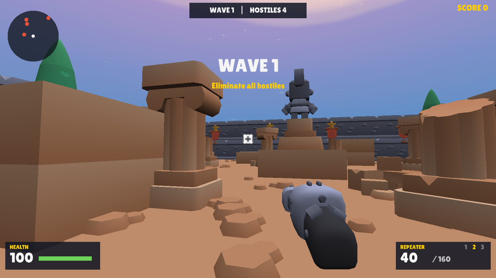

<div align="center">

# 🎯 Arena Shooter

---

**A 3D wave-survival first-person shooter. Play it in your browser or on Windows.**<br>
**Hold the Colosseum, the Sky Garden or Downtown — every wave sends one more.**

[](https://abahodirov.github.io/arena-shooter/)&nbsp;[](https://github.com/abahodirov/arena-shooter/releases/latest/download/ArenaShooter.exe)




</div>

## Features

- **Three arenas** — Colosseum (walled sand arena with columns for cover), Sky Garden (floating islands above the clouds, no walls), and Downtown (a city block with long sight lines down the streets)
- **Three weapons** — a precise semi-auto Blaster, a full-auto Repeater, and a one-swing Sword, each with its own crosshair, spread and recoil
- **Endless waves** — every wave adds another hostile up to 12 at once, mixing ground soldiers with flying drones that scale in health as you go
- **Three difficulties** — Easy, Normal and Hard change enemy accuracy, damage and health
- **Scoring with headshots** — 100 points per soldier, 75 per drone, double damage and +50 for a headshot, plus a 250 × wave clear bonus
- **Pickups** — coins for score and ammo crates for the Repeater drop from fallen enemies
- **Full settings menu** — mouse sensitivity, FOV, volume and fullscreen, saved between sessions along with a per-map personal best
- **End-of-run scoreboard** — wave reached, kills, headshots and shot accuracy

## Versions

| Version | How to play | Code |
| --- | --- | --- |
| **Browser** | Open **[abahodirov.github.io/arena-shooter](https://abahodirov.github.io/arena-shooter/)**: nothing to install. Chrome, Edge or Firefox with a keyboard and mouse. | [`web/`](web) (JavaScript, three.js) |
| **Windows** | Download **[ArenaShooter.exe](https://github.com/abahodirov/arena-shooter/releases/latest/download/ArenaShooter.exe)** and double-click it. | [`fps_game.py`](fps_game.py) packaged with PyInstaller |
| **Source** | `python fps_game.py` on Windows, macOS or Linux. | [`fps_game.py`](fps_game.py) (Python, Ursina) |

The browser version is a port of the desktop game: same maps (laid out with the same random seeds), weapons, enemies, waves, scoring and menus. Differences: crouch is `C` (Ctrl+W would close the tab; `C` works on desktop too), settings and best scores live in the browser instead of `settings.json`, and there is no Quit button. Each release on the [Releases page](https://github.com/abahodirov/arena-shooter/releases) carries the Windows exe and a zip of the browser version.

## Play in the browser

Open **[https://abahodirov.github.io/arena-shooter/](https://abahodirov.github.io/arena-shooter/)**, click **PLAY**, pick a map and click **START**. The game captures the mouse for aiming; **Esc** releases it and pauses. To run the browser version locally:

```bash
python tools/build_web.py              # assembles web/ + assets/ into _site/
python -m http.server -d _site 8000    # then open http://localhost:8000
```

Every push to `main` redeploys it through [.github/workflows/pages.yml](.github/workflows/pages.yml).

## Play on Windows (no install)

Download **[ArenaShooter.exe](https://github.com/abahodirov/arena-shooter/releases/latest/download/ArenaShooter.exe)** from the [latest release](https://github.com/abahodirov/arena-shooter/releases/latest) and double-click it. No Python needed. If SmartScreen warns about an unrecognized app, choose **More info → Run anyway** (the exe isn't code-signed). Settings and best scores are saved in `settings.json` next to the exe.

## Requirements (running from source)

- Python 3.9 or newer (developed on 3.11)
- Windows, macOS or Linux with a GPU that supports OpenGL 3.2+

## Install & run

```bash
git clone https://github.com/abahodirov/arena-shooter.git
cd arena-shooter
pip install -r requirements.txt
python fps_game.py
```

`fps_game.py` installs Ursina itself on first run if it is missing, so `python fps_game.py` alone also works. Keep the `assets` folder next to the script — the game exits with an error if it is missing.

## Building the .exe yourself

```bash
pip install pyinstaller
pyinstaller --noconfirm --onefile --windowed --name ArenaShooter --icon docs/img/crosshair.png --add-data "assets;assets" --collect-all ursina --collect-all panda3d --collect-all gltf --collect-all direct --exclude-module pygame fps_game.py
```

The exe is written to `dist/ArenaShooter.exe`.

## Controls

| Action | Key |
| --- | --- |
| Move | `W` `A` `S` `D` |
| Jump | `Space` |
| Look | Mouse |
| Fire / swing | Left mouse |
| Reload | `R` |
| Select weapon | `1` `2` `3` |
| Previous weapon | `Q` |
| Aim down sights | Right mouse |
| Sprint | `Shift` |
| Crouch | `C` (or `Left Ctrl` on desktop) |
| Scoreboard | `Tab` (hold) |
| Cycle weapons | Mouse wheel |
| Pause / back | `Esc` |
| Restart after dying | `Enter` |

## Project layout

```
fps_game.py        the desktop game - engine setup, maps, weapons, enemies, HUD and menus
requirements.txt   the single dependency (ursina)
assets/            models, sprites, sounds, UI art and the font (shared by both versions)
web/               the browser version
  index.html       page, HUD/menu styles
  js/game.js       player, weapons, enemies, waves, HUD, menus (port of fps_game.py)
  js/maps.js       the three arenas
  js/engine.js     colliders + raycasts, tweens, sound, asset loading
  js/rng.js        Python-compatible random numbers, so maps match the desktop layout
  download.html    the download page
  vendor/          three.js r170 (MIT)
tools/build_web.py assembles the site for GitHub Pages
docs/img/          screenshots
settings.json      created on first run: your settings and high scores (not tracked)
```

## Credits

All art and audio are free third-party assets — nothing in `assets/` was drawn or recorded for this game. Full attribution is in [assets/CREDITS.txt](assets/CREDITS.txt).

- **3D models, sprites, UI art and sounds** — [Kenney](https://www.kenney.nl) ([CC0 1.0](http://creativecommons.org/publicdomain/zero/1.0/))
- **Font** — Lilita One by Juan Montoreano ([SIL Open Font License 1.1](assets/fonts/OFL-license.txt))
- **Engine** — desktop: [Ursina](https://www.ursinaengine.org/) (MIT) on [Panda3D](https://www.panda3d.org/) (BSD); browser: [three.js](https://threejs.org/) (MIT, bundled in `web/vendor/`)

## License

The game code is released under the [MIT License](LICENSE). The bundled assets keep their own licenses — see [NOTICE](NOTICE) for the third-party notices and [assets/CREDITS.txt](assets/CREDITS.txt) for the full per-folder attribution.
